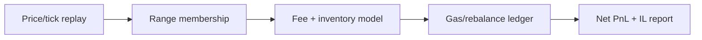

# Uniswap V3 Market Microstructure & Liquidity Provision Simulator

A historical-replay style simulator for concentrated liquidity positions. It measures time-in-range, fee income, gas/rebalancing cost, and net value under static or dynamic range policies.

## Architecture


## Structural overview
`src/lp_simulator/sim.py` owns the replay and accounting model; `cli.py` is the thin experiment entry point; `tests/` locks down deterministic behavior.

## Workflow
1. Replay a deterministic price path.
2. Mark whether price is inside the LP range.
3. Accrue fees from realized movement while in range.
4. Charge gas when a dynamic policy changes exposure.
5. Compare net value with a passive hold benchmark.

## Design rationale
The simulator keeps inventory and costs explicit instead of hiding them behind an APY formula. Static ranges provide a clean benchmark; dynamic ranges are useful only when the extra fees exceed rebalancing and adverse-selection costs.

## Run
```bash
pip install -e .
python -m lp_simulator.cli --output reports/lp-summary.json
pytest -q
```

The CLI writes a JSON summary when `--output` is provided. The synthetic price path is a fixture; a production adapter should supply timestamped pool prices and decoded liquidity snapshots.

## Live adapter boundary
`lp_simulator.rpc.JsonRpcClient` supplies the same network boundary for pool-state adapters. The simulator remains independent of RPC transport so historical snapshots can be replayed offline.

### Credential-dependent blockers
Live pool replay requires RPC access plus Uniswap V3 ABI decoding for ticks, liquidity, and swaps. The current price-path model is an intentionally transparent approximation.

## Environment

Copy `.env.example` and set `RPC_URL` only when a reachable provider is available. The adapters do not embed credentials and never run implicitly during tests.

## Limitations
The current engine uses a price-level approximation rather than full Uniswap tick liquidity and sqrt-price accounting. It is a research scaffold; validate against decoded pool state before using it for capital allocation.
