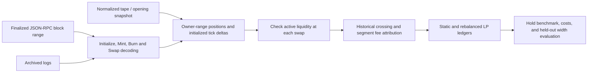
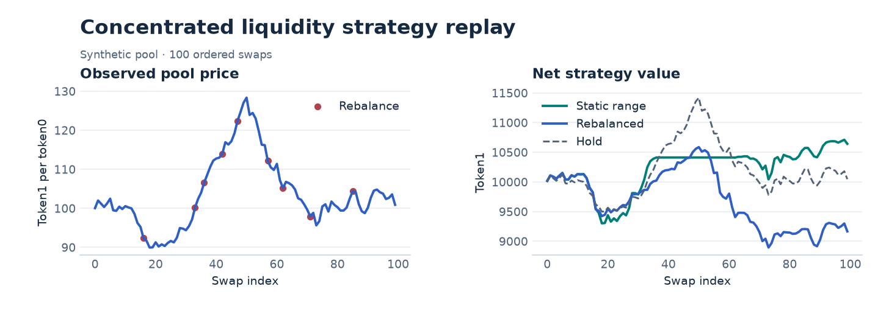

# Uniswap V3 Market Microstructure & Liquidity Provision Simulator

Reconstruct Uniswap V3 pool liquidity from ordered events, check active liquidity against the emitted Swap state, and replay static or rebalanced LP ranges on the observed path.

## Run the complete example

Requires Python 3.11 or later.

```bash
python -m pip install -e '.[test]'
uniswap_v3_lp_simulator --write-tape reports/demo-tape.json \
  --ledger reports/strategy-ledger.csv --output reports/replay.json
uniswap_v3_lp_simulator --input reports/demo-tape.json \
  --width-candidates 400 600 900 --holdout-fraction 0.25 \
  --ledger reports/holdout-ledger.csv --output reports/holdout.json
python -m pytest -q
```

The Docker image exposes the same CLI entry point.

## Architecture



| Layer | Behavior |
|---|---|
| `events.py` | Reads bounded, finalized block ranges by chain ID or decodes captured EVM pool logs. |
| `tape.py` | Defines chain and pool metadata, ordered events, tick spacing, opening snapshots, and strategy assumptions. |
| `pool_state.py` | Maintains exact integer liquidity by owner and range and calculates per-tick active liquidity from cumulative net changes. |
| `positions.py` | Converts sqrt-price to inventory, estimates share of swap fees within crossed ranges, and charges rebalance gas and turnover. |
| `replay.py` | Compares strategies and optionally chooses a width on a chronological prefix before testing it on later swaps. |

## Historical inputs and accounting

A metadata file supplies `chain_id`, `pool`, `token0_decimals`, `token1_decimals`, `fee_pips` and `tick_spacing`. The event history starts at `Initialize` or uses a complete opening snapshot from an earlier block. The snapshot includes `block`, `tick`, `sqrt_price_x96`, `active_liquidity` and nonzero owner-range positions. Each normalized event carries `block` and `log_index` plus its ABI-derived fields. Retain the block and transaction hashes with recorded data.

```bash
uniswap_v3_lp_simulator --raw-logs data/pool-logs.json \
  --metadata data/pool-metadata.json --output reports/historical.json
uniswap_v3_lp_simulator --network ethereum --rpc-range 26486690 26486702 \
  --metadata examples/ethereum-pool.json --output reports/ethereum-smoke.json
uniswap_v3_lp_simulator --raw-logs examples/arbitrum-opening-logs.json \
  --metadata examples/arbitrum-pool.json --output reports/arbitrum-smoke.json
```

For the RPC command, set `RPC_URL` to an endpoint that serves the requested range and supports the `finalized` block tag. The Ethereum example replayed one observed swap from recorded initialization onward. The Arbitrum example includes eight raw pool events from finalized blocks 100,909 to 228,740, captured from the public Arbitrum One RPC. Those logs reconstruct the opening pool positions and reconcile four observed swaps offline.

- Strategy ranges use the pool's tick spacing and Q64.96 spot prices with decimals normalization. The ledger reports token1 units and carries both token balances and the equivalent spot valuation.
- Fees are an estimate based on historical input flows, segment liquidity and LP share. The historical pool price path is held fixed for both counterfactual strategies.
- Rebalancing happens after the observed swap, uses the post-swap mark, and spends inventory value on gas and modeled turnover slippage. The selected width is trained only on the prefix and held fixed for the subsequent evaluation.
- Reported range coverage is the fraction of observed swap endpoints inside the pre-rebalance range. The static inventory-to-hold figure measures divergence against the same initial token amounts. The dynamic figure also reflects prior rebalance costs and adopted exposures.

[Uniswap V3 pool event definitions](https://github.com/Uniswap/v3-core/blob/main/contracts/interfaces/pool/IUniswapV3PoolEvents.sol) · [Uniswap V3 TickMath](https://github.com/Uniswap/v3-core/blob/main/contracts/libraries/TickMath.sol) · [Ethereum JSON-RPC](https://ethereum.org/developers/docs/apis/json-rpc/)

## Reproduced demo results

The synthetic tape contains 100 swaps. With the default strategy settings, the static range ends at 10,641.04 token1. The dynamic range rebalances nine times and ends at 9,164.64 token1. Both start at 10,000 token1.



## Commit dates

Both Git date fields on the 40 commits in the November 2026 portfolio update
use retrospectively assigned milestones from 2026-05-01 through 2026-06-30,
the project period listed in the résumé. Each commit records its assigned date
in the Project-Milestone trailer and its original committer timestamp in
the Original-Commit-Date trailer. Use git log --format=fuller to inspect the dates.

## Inspect a bounded replay

Use `--from-swap` and `--until-swap` to run a half-open swap interval.
Earlier pool events warm up state, while strategy positions open at the
selected interval. The evaluation records both source log positions.

Export exact terminal liquidity with `--pool-state-json reports/state.json`.
Owner ranges and signed net and gross tick amounts are serialized as decimal
strings. A tick can have gross liquidity with zero net change. Ledger rows
include the prior tick and Q64.96 price, input notional, rebalance reason, and
turnover. Strategy summaries measure peak-to-trough drawdown from initial
capital.
